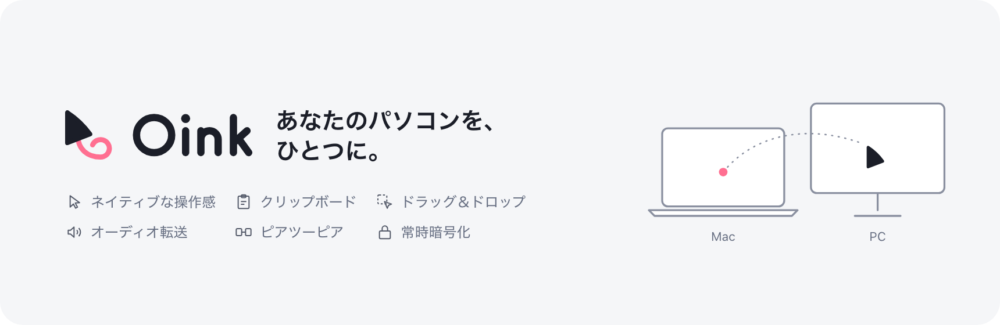

  <picture>
    <source media="(prefers-color-scheme: dark)" srcset=".github/assets/banner-ja-dark.png">
    
  </picture>

# Oink — Oink Is Not only a KVM

[English](README.md) | [简体中文](README.zh-CN.md) | **日本語** | [한국어](README.ko.md)

Oink は「Oink Is Not only a KVM」の略で、複数の Windows と Mac のあいだにピアツーピアの共有ネットワークを構築するモダンなソフトウェアです。どのデバイスのキーボード・マウス・トラックパッドでも近くの任意のデバイスを操作でき、どこでも統一されたネイティブな操作感を保ちます。複数のデバイスの音声を 1 台のデバイスにつないだスピーカーやヘッドホンで再生でき、クリップボードの共有とデバイス間のドラッグ＆ドロップ、ローカルネットワーク上のデバイスの自動検出に対応し、通信はデフォルトで暗号化されます。

> Oink は個人プロジェクトです。コードはすべて AI が書いており（Claude Code と Codex に感謝します）、人間はプロジェクト管理、技術的な方向性の決定、そして AI を励ますことを担当しています。多様な環境では十分にテストされておらず、特に次の環境は未検証です：
>
> 1. 複数のディスプレイを持つ Windows コンピュータ
> 2. タッチパッド付きの Windows ノート PC
> 3. Windows 10、および最新の macOS に更新されていない Mac
>
> お使いの環境では一部の機能が正しく動作しない可能性があります。フィードバックをくださるすべての方に感謝します。

## インストール

インストーラーと対応するソースコードは [GitHub Releases](https://github.com/oinkvm/oink/releases) から入手できます。

対応 OS とバージョン：

- **Mac**：Apple シリコン（arm64）のみ、macOS 14.2 以降
- **Windows**：x64、Windows 10 22H2（ビルド 19045）以降、または Windows 11

SmartScreen に「Windows によって PC が保護されました」と表示された場合は、選択肢が表示されたときに限り **詳細情報 → 実行** を選んでください。UAC では発行元が不明と表示されることがあります。

### スポンサー

このプロジェクトがお役に立てたなら、AI サブスクリプション費用の一部をご支援いただけるとうれしいです。そのトークンが Oink をより良くします。

## コントリビューション

コードをレビューできる人がいないため、背景の説明がないプルリクエストは受け付けていません。不具合の報告や機能のリクエストは [Issues](https://github.com/oinkvm/oink/issues) へお寄せください。問題を報告する際は、デバイスの環境、診断データ、再現手順、そして AI による調査の結論を添えていただけると助かります。実際の環境で使ってフィードバックをいただくことが、このプロジェクトへの最大の貢献です。

## よくある質問

**Oink は Deskflow をベースにしていますか、または Deskflow と互換性がありますか？**\
いいえ。Oink はゼロから作られたプロジェクトで、独自のピアツーピア（クライアント／サーバー型ではない）プロトコルを使っており、他のソフトウェア KVM とは互換性がありません。

**どれか 1 台をコントロール側として指定する必要がありますか？**\
いいえ。Oink はピアツーピア設計なので、どのデバイスにつないだキーボードとマウスでも他のデバイスを操作できます。

**トラックパッドのジェスチャーは共有できますか？**\
はい。ただし Windows のタッチパッドはテストされていません。

**OS をまたいだクリップボード共有やデバイス間のドラッグ＆ドロップに対応していますか？**\
はい。クリップボードはデバイス間で自動的に同期され、テキスト・画像・ファイルをあるデバイスから別のデバイスへ直接ドラッグできます。Chrome などのアプリに直接ドロップすることもできます。

**Linux には対応していますか？**\
現時点では対応していません。将来追加する可能性があります。

**個人利用や商用利用のためにライセンスを購入する必要はありますか？**\
いいえ。Oink は GPL-3.0-only（追加条項付き）で公開されている自由ソフトウェアで、個人・商用を問わずどんな目的にも、追加のライセンスなしで利用できます。Oink やその改変版を配布する場合は、同じライセンスで完全なソースコードを提供し、原作者の表示とライセンス表記を残し、変更点を明示する必要があります。追加条項により、派生製品の宣伝に Oink の名称を使うこともできません。配布せず自分で使うためだけに改変する場合、これらの義務はありません。

## ライセンス

このプロジェクトは [GPL-3.0-only](LICENSE) と[追加条項](LICENSE-ADDITIONAL-TERMS.md)のもとで公開されています。
