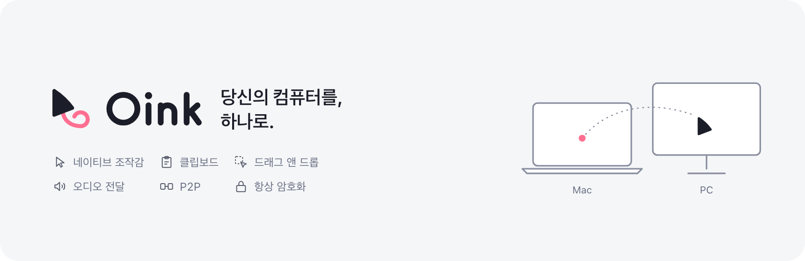

  <picture>
    <source media="(prefers-color-scheme: dark)" srcset=".github/assets/banner-ko-dark.png">
    
  </picture>

# Oink — Oink Is Not only a KVM

[English](README.md) | [简体中文](README.zh-CN.md) | [日本語](README.ja.md) | **한국어**

Oink는 "Oink Is Not only a KVM"의 약자로, 여러 대의 Windows와 Mac 사이에 P2P 공유 네트워크를 구축하는 최신 소프트웨어입니다. 어느 기기의 키보드, 마우스, 트랙패드로든 가까운 다른 기기를 조작할 수 있으며, 어디서나 통일된 네이티브 조작감을 유지합니다. 여러 기기의 오디오를 한 기기에 연결된 스피커나 헤드폰으로 재생할 수 있고, 클립보드 공유와 기기 간 드래그 앤 드롭, 로컬 네트워크 기기 자동 검색을 지원하며, 모든 통신은 기본적으로 암호화됩니다.

> Oink는 개인 프로젝트입니다. 코드는 모두 AI가 작성했으며(Claude Code와 Codex에 감사드립니다), 사람은 프로젝트 관리, 기술 방향 결정, 그리고 AI를 격려하는 일을 맡고 있습니다. 다양한 환경에서 충분히 테스트되지 않았으며, 특히 다음 환경은 검증되지 않았습니다.
>
> 1. 디스플레이가 여러 대인 Windows 컴퓨터
> 2. 터치패드가 있는 Windows 노트북
> 3. Windows 10 및 최신 macOS로 업데이트하지 않은 Mac
>
> 사용 중인 환경에서 일부 기능이 제대로 동작하지 않을 수 있습니다. 피드백을 보내 주시는 모든 분께 감사드립니다.

## 설치

[GitHub Releases](https://github.com/oinkvm/oink/releases)에서 설치 파일과 해당 소스 코드를 받을 수 있습니다.

지원하는 운영체제와 버전:

- **Mac**: Apple 실리콘(arm64)만 지원, macOS 14.2 이상
- **Windows**: x64, Windows 10 22H2(빌드 19045) 이상 또는 Windows 11

SmartScreen에 "Windows의 PC 보호" 메시지가 표시되면, 해당 옵션이 있을 때만 **추가 정보 → 실행**을 선택하세요. UAC에서 게시자를 알 수 없음으로 표시될 수 있습니다.

### 후원

이 프로젝트가 도움이 되셨다면 AI 구독료 일부를 후원해 주세요. 그 토큰 덕분에 Oink가 더 좋아질 수 있습니다.

## 기여

코드를 리뷰할 사람이 없기 때문에 맥락 설명이 없는 풀 리퀘스트는 받지 않습니다. 버그 보고와 기능 요청은 모두 [Issues](https://github.com/oinkvm/oink/issues)로 보내 주세요. 문제를 보고할 때는 기기 환경, 진단 데이터, 재현 절차, 그리고 AI로 조사한 결론을 함께 적어 주시면 좋습니다. 실제 환경에서 사용하고 피드백을 주시는 것이 이 프로젝트에 대한 가장 큰 기여입니다.

## 자주 묻는 질문

**Oink는 Deskflow 기반이거나 Deskflow와 호환되나요?**\
아니요. Oink는 처음부터 새로 만든 프로젝트로, 자체 개발한 P2P(클라이언트-서버 방식이 아닌) 프로토콜을 사용하며 다른 소프트웨어 KVM과 호환되지 않습니다.

**한 기기를 제어 기기로 지정해야 하나요?**\
아니요. Oink는 P2P 방식으로 설계되어 어느 기기에 연결된 키보드와 마우스로든 다른 기기를 제어할 수 있습니다.

**트랙패드 제스처를 공유할 수 있나요?**\
네. 다만 Windows 터치패드는 테스트되지 않았습니다.

**운영체제를 넘나드는 클립보드 공유와 기기 간 드래그 앤 드롭을 지원하나요?**\
네. 클립보드는 기기 간에 자동으로 동기화되며, 텍스트, 이미지, 파일을 한 기기에서 다른 기기로 바로 드래그할 수 있습니다. Chrome 같은 앱 안으로 바로 드롭할 수도 있습니다.

**Linux를 지원하나요?**\
아직 지원하지 않습니다. 앞으로 추가될 수 있습니다.

**개인 또는 상업적 용도로 사용하려면 라이선스를 구매해야 하나요?**\
아니요. Oink는 GPL-3.0-only(추가 조항 포함)로 배포되는 자유 소프트웨어로, 개인이든 상업적이든 어떤 용도로도 별도의 라이선스 없이 사용할 수 있습니다. Oink 또는 수정한 버전을 배포하는 경우에는 같은 라이선스로 전체 소스 코드를 제공하고, 원작자 표시와 라이선스 고지를 유지하며, 변경 사항을 명시해야 합니다. 추가 조항에 따라 파생 제품을 홍보하는 데 Oink라는 이름을 사용할 수도 없습니다. 배포하지 않고 직접 사용하기 위해서만 수정하는 경우에는 이러한 의무가 없습니다.

## 라이선스

이 프로젝트는 [GPL-3.0-only](LICENSE) 라이선스와 [추가 조항](LICENSE-ADDITIONAL-TERMS.md)에 따라 배포됩니다.
