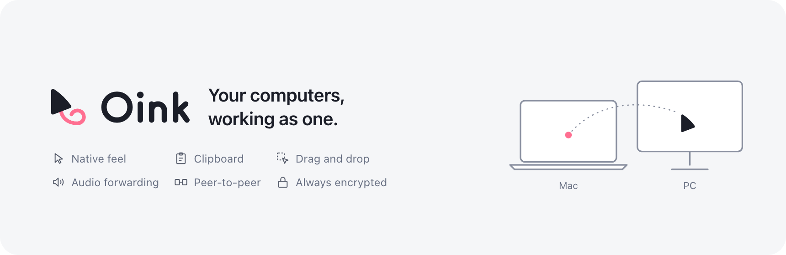

  <picture>
    <source media="(prefers-color-scheme: dark)" srcset=".github/assets/banner-dark.png">
    
  </picture>

# Oink — Oink Is Not a KVM

**English** | [简体中文](README.zh-CN.md) | [日本語](README.ja.md) | [한국어](README.ko.md)

Oink, short for "Oink Is Not a KVM", is modern software that builds a peer-to-peer sharing network across multiple Windows and Mac computers. Use the keyboard, mouse and trackpad of any device to control any nearby device, with the same native feel everywhere; play the audio of several devices through the speakers or headphones connected to one of them; share the clipboard and drag and drop between devices; discover devices on the local network automatically; all traffic is encrypted by default.

> Oink is a personal project. All of its code was written by AI (thanks to Claude Code and Codex); the human manages the project, sets the technical direction and encourages the AI. The project has not been thoroughly tested in diverse environments, especially:
>
> 1. computers with multiple displays
> 2. Windows laptops with touchpads
> 3. Windows 10, and Macs that are not on an up-to-date macOS
>
> Some features may not work in your environment. Many thanks to everyone who sends feedback.

## Install

Get installers and matching source from [GitHub Releases](https://github.com/oinkvm/oink/releases).

Supported operating systems and versions:

- **Mac:** Apple silicon (arm64) only, macOS 14.2+
- **Windows:** x64, Windows 10 22H2 (build 19045)+ or Windows 11

If SmartScreen says "Windows protected your PC", use **More info → Run anyway** only if offered. UAC may show an unknown publisher.

### Sponsor

If this project helps you, consider sponsoring some of my AI subscription costs. Those tokens help make Oink better.

## Contributing

This project does not accept pull requests without context, because there is no one to review the code. Please use [Issues](https://github.com/oinkvm/oink/issues) for all bug reports and feature requests. When you report a problem, please include your device environment, diagnostic data, steps to reproduce and your AI-assisted investigation's conclusions. Using Oink in real environments and sending feedback is the biggest contribution to this project.

## FAQ

**Is Oink based on, or compatible with, Deskflow?**\
No. Oink is a project started completely from scratch. It uses its own peer-to-peer (not client–server) protocol and is not compatible with other software KVMs.

**Do I have to designate one device as the controller?**\
No. Oink uses a peer-to-peer design: the keyboard and mouse connected to any device can control the other devices.

**Can I share trackpad gestures?**\
Yes, but trackpads on Windows have not been tested.

**Does it support clipboard sharing and drag and drop across operating systems?**\
Yes. The clipboard is synced across devices automatically, and you can drag text, images and files directly from one device to another — even straight into apps such as Chrome.

**Does Oink support Linux?**\
Not yet. It may be added in the future.

**Do I need to buy a license for personal or commercial use?**\
No. Oink is free software released under GPL-3.0-only with additional terms, so you can use it for any personal or commercial purpose without asking for any further license. If you distribute Oink or a modified version of it, you must provide the complete source code under the same license, keep the original author attribution and license notices, and mark your changes; under the additional terms you also may not use the Oink name to promote derived products. Modifying Oink only for your own use, without distributing it, carries none of these obligations.

## License

This project is licensed under [GPL-3.0-only](LICENSE) with [additional terms](LICENSE-ADDITIONAL-TERMS.md).
