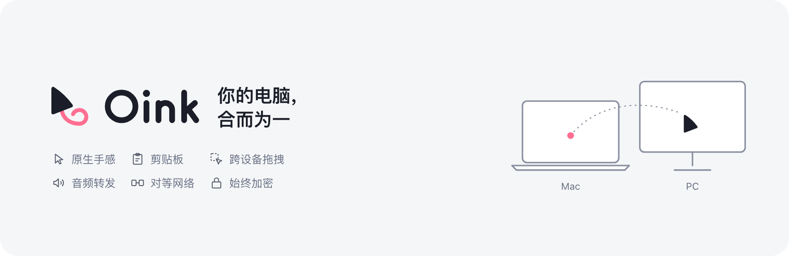

  <picture>
    <source media="(prefers-color-scheme: dark)" srcset=".github/assets/banner-zh-CN-dark.png">
    
  </picture>

# Oink — Oink Is Not only a KVM

[English](README.md) | **简体中文** | [日本語](README.ja.md) | [한국어](README.ko.md)

Oink 是 Oink Is Not only a KVM 的缩写，是一款在多台 Windows 和 Mac 设备间建立对等共享网络的现代软件。同时使用任何设备的键盘、鼠标、触摸板操控任意邻近设备，保持统一、原生的操作手感；将多台设备的音频通过连接至一台设备的扬声器或耳机播放；支持剪贴板共享和跨设备拖拽；支持局域网设备自动发现；默认加密传输。

> Oink 是一个个人项目，代码完全由 AI 编写（感谢 Claude Code 和 Codex），人类负责项目管理、确定技术方向和鼓励 AI。项目没有在多样化环境内经过充分测试，尤其是：
>
> 1. 有多个显示器的 Windows 计算机
> 2. 带触摸板的 Windows 笔记本
> 3. Windows 10 和未更新系统的 Mac
>
> 某些功能可能在你的环境内不能正常工作，十分感谢所有为该项目提供反馈的用户。

## 安装

从 [GitHub Releases](https://github.com/oinkvm/oink/releases) 下载安装包和对应的源码。

支持的操作系统和版本：

- **Mac**：仅支持 Apple 芯片（arm64），macOS 14.2 及以上
- **Windows**：x64，Windows 10 22H2（build 19045）及以上，或 Windows 11

如果 SmartScreen 提示“Windows 已保护你的电脑”，仅在出现相应选项时点击 **更多信息 → 仍要运行**。UAC 可能显示发布者未知。

### 赞助

如果这个项目帮助到了你，可以考虑赞助我一些 AI 订阅费用。这些 Token 会让 Oink 发展得更好。

## 贡献

本项目不接受没有上下文的 PR，因为没有人能对代码进行 Review。欢迎通过 [Issues](https://github.com/oinkvm/oink/issues) 提交一切问题反馈和功能请求，在反馈问题时，最好能带上你的设备环境、诊断数据、复现流程和 AI 排查结论。在真实环境中使用和反馈是对该项目的最大贡献。

## 常见问题

**Oink 是基于 Deskflow 或兼容 Deskflow 的吗？**\
不是。Oink 是完全从零开始的项目，使用自研的对等（非客户端-服务端）协议，不兼容其他软件 KVM。

**必须指定一台设备为控制端吗？**\
不必须。Oink 采用对等网络设计，连接在任何设备上的键鼠都可以用来控制其他设备。

**支持共享触摸板手势吗？**\
支持，但 Windows 触摸板未经过测试。

**支持跨操作系统的剪贴板共享和跨设备拖拽吗？**\
支持。剪贴板会在设备间自动同步，也可以直接将文字、图片、文件从一台设备拖拽到另一台设备，甚至直接拖进 Chrome 等应用内。

**支持 Linux 吗？**\
暂不支持，未来可能会添加。

**个人或商业使用 Oink 需要购买许可吗？**\
不需要。Oink 是以 GPL-3.0-only（附带附加条款）发布的自由软件，可以用于任何个人或商业用途，无需申请额外许可。如果分发 Oink 或基于它修改的版本，必须以同一许可证提供完整源码，保留原作者署名和许可声明，并标明所做的修改；按附加条款，也不得以 Oink 的名义推广衍生产品。仅供自己使用的修改、不对外分发时，没有这些义务。

## 许可证

本项目以 [GPL-3.0-only](LICENSE) 许可证发布，并附有[附加条款](LICENSE-ADDITIONAL-TERMS.md)。
